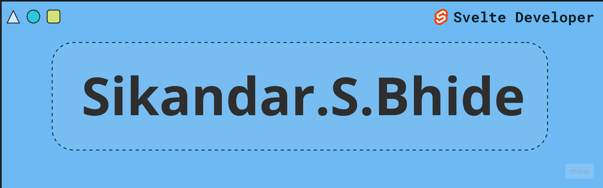

  

# A Passionate SvelteKit developer from India.

Building high-quality Svelte components, AI tools, and developer-focused projects.

Portfolio : [Bhide Svelte](https://bhide.dev)

## Open Source Projects

- [Svelte Animations (New)](https://sv-animations.vercel.app) - 50+ animation components and modern UI effects built for Svelte 5.
- [Svelte Animations](https://animation-svelte.vercel.app) - 200+ animation components and modern UI effects built for Svelte 4.
- [Svelte AI Elements](https://svelte-ai-elements.vercel.app) - Build AI-native apps faster with prebuilt Svelte components powered by the Vercel AI SDK.
- [Svelte Marketing Blocks](https://sv-blocks.vercel.app) - 150+ Free and open-source marketing blocks for landing pages and startup websites.
- [Svelte Efferd Blocks](https://sv-efferd.pages.dev) - 60 Modern marketing blocks for Svelte inspired by Efferd Blocks.
- [Svelte Form Builder](https://svelte-form-builder.vercel.app) - Create forms quickly with shadcn-svelte, Superforms, and schema validation.
- [Framer Ground](https://github.com/SikandarJODD/framer-ground-svelte) - Experimental motion effects and transitions built with Svelte.
- [Youva Template](https://github.com/SikandarJODD/youva) - Learn pagination, caching, filtering, sorting, and search with SvelteKit.

## Library

- [Svelte Agentation](https://sv-agentation.com) - Turn UI annotations into structured context for AI coding tools.

## Tech Stack

  

  

  

